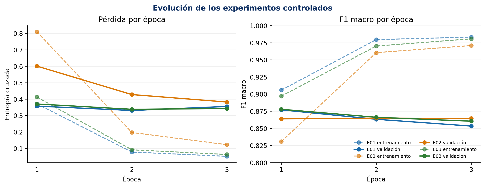
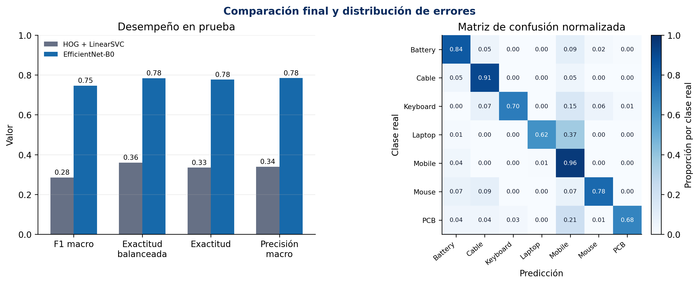

# Clasificación visual de residuos electrónicos con ETID

## Informe técnico final del proyecto integrador

**Asignatura:** Técnicas Avanzadas de Modelado en IA MIA 2026-5  
**Unidad:** 4 — Actividad 3  
**Integrantes:** Sebastian Mejia Ortiz · Laura Mariana Jimenez Mienez · Luis Gonzalo Duran  
**Docente:** Oscar Alberto Rodriguez Melendez  
**Fecha:** 17 de octubre de 2026

---

## Resumen

Clasificar un residuo electrónico a partir de una fotografía parece una tarea sencilla hasta que cambian el fondo, el encuadre, el estado del objeto o la procedencia de la imagen. Este proyecto evaluó si una red EfficientNet-B0 con transferencia de aprendizaje podía superar una referencia HOG + LinearSVC en la clasificación de siete categorías del conjunto E-Tadweer Image Dataset (ETID): batería, cable, teclado, computador portátil, teléfono móvil, ratón y tarjeta de circuito impreso. La comparación se diseñó sobre grupos de procedencia independientes para reducir el riesgo de fuga entre imágenes relacionadas. De 6.269 archivos legibles se excluyeron dos copias binarias y se corrigieron nueve etiquetas sin alterar los originales; el conjunto experimental quedó conformado por 4.289 imágenes de entrenamiento, 983 de validación y 995 de prueba.

La selección del modelo se realizó exclusivamente con validación. Tres experimentos controlados modificaron la tasa de aprendizaje o el *dropout*, y un intento posterior de ajuste fino fue rechazado porque no superó el checkpoint seleccionado. En prueba, HOG + LinearSVC obtuvo un F1 macro de 0,2849, mientras EfficientNet-B0 alcanzó 0,7461: una mejora absoluta de 0,4612, con intervalo *bootstrap* pareado del 95 % entre 0,4237 y 0,5022. Sin embargo, el F1 descendió 0,1316 entre validación y prueba, y las clases `Cable` y `Mobile` mostraron desequilibrios importantes entre precisión y *recall*. El resultado responde afirmativamente la pregunta experimental dentro de ETID, pero no respalda todavía un uso autónomo. La solución se considera una referencia académica reproducible y, a lo sumo, un apoyo supervisado cuya adopción requeriría validación externa, calibración y un mecanismo de abstención.

**Palabras clave:** residuos electrónicos, visión por computador, EfficientNet-B0, transferencia de aprendizaje, reproducibilidad.

## 1. Problema, contexto y objetivo

La primera clasificación en un punto de recepción de residuos electrónicos suele depender de una inspección humana. El trabajo se complica cuando se reciben objetos dañados, incompletos o fotografiados en condiciones distintas. Una sugerencia visual podría agilizar el inventario inicial, pero una clasificación equivocada también puede trasladar el error a etapas posteriores. Por esa razón, el proyecto no se planteó como un sistema de disposición final, sino como una evaluación controlada de la capacidad de reconocer siete tipos de objetos.

El usuario previsto es el personal de un punto de recepción o inventario que requiere una sugerencia inicial de categoría. La unidad de análisis es una imagen RGB y la salida es una entre siete clases: `Battery`, `Cable`, `Keyboard`, `Laptop`, `Mobile`, `Mouse` o `PCB`. Se excluyeron de manera explícita la detección de múltiples objetos, la segmentación, la identificación de marca o modelo, el diagnóstico físico, la composición química, la peligrosidad y la decisión de reciclabilidad. En especial, una predicción nunca debe autorizar por sí sola la manipulación de una batería u otro elemento potencialmente peligroso.

La pregunta que orientó todo el ciclo fue: **¿EfficientNet-B0 con transferencia de aprendizaje mejora el F1 macro frente a HOG + LinearSVC cuando ambos modelos se evalúan sobre grupos de procedencia independientes?** Esta formulación fijó tres exigencias: comparar sobre las mismas observaciones, impedir que el conjunto de prueba influyera en la selección y utilizar una métrica sensible al desempeño de todas las clases. La línea base no fue un trámite; proporcionó el umbral mínimo contra el cual debía justificarse la complejidad adicional de la red.

Antes de entrenar la red se fijó un criterio verificable: alcanzar en la misma prueba un F1 macro de al menos 0,3149 —tres puntos porcentuales absolutos por encima de la línea base— sin reducir el *recall* de `Cable` por debajo de 0,4091. También se acordó estimar mediante *bootstrap* un intervalo del 95 % para la diferencia de F1 macro. El proyecto debía, además, conservar trazabilidad sobre datos, parámetros, semillas, resultados y checkpoint. Estas condiciones siguen la recomendación de comenzar con una referencia simple y controlar el proceso experimental antes de aumentar complejidad (Zinkevich, s. f.).

## 2. Datos y ficha del dataset

ETID versión 1 fue publicado por Sayed et al. (2026) en Mendeley Data bajo licencia Creative Commons Attribution 4.0. El dataset reúne imágenes de residuos electrónicos procedentes de varias colecciones y las organiza en siete categorías. Su disponibilidad pública y su correspondencia con una tarea multiclase hacían posible auditar los archivos, establecer una línea base y repetir el experimento sin redistribuir las imágenes desde el repositorio del equipo.

La auditoría abrió correctamente 6.269 archivos y encontró 61 resoluciones. Dos imágenes eran copias binarias ubicadas en clases distintas; se excluyeron para impedir que una misma señal apareciera con etiquetas incompatibles. Nueve observaciones fueron reetiquetadas después de contrastar el nombre del archivo, la carpeta de origen y la inspección visual. Los originales permanecieron intactos: las decisiones se aplicaron en un manifiesto versionado, un principio coherente con la trazabilidad propuesta para documentar conjuntos de datos (Gebru et al., 2021).

| Partición | Imágenes | Grupos de procedencia | Función experimental |
|---|---:|---:|---|
| Entrenamiento | 4.289 | 16 | Ajuste de parámetros del modelo |
| Validación | 983 | 6 | Selección, parada temprana e hiperparámetros |
| Prueba | 995 | 8 | Evaluación final única |

La clase `Cable` es la menos representada: contiene 127 ejemplos de entrenamiento y solo 22 de prueba. En contraste, `Battery` aporta 1.007 imágenes de entrenamiento y 244 de prueba. Esta asimetría vuelve insuficiente una lectura basada únicamente en exactitud y explica la elección del F1 macro, que asigna el mismo peso a cada clase sin importar su frecuencia.

### Ficha breve del dataset

| Elemento | Descripción |
|---|---|
| Propósito en el proyecto | Evaluar clasificación visual multiclase de residuos electrónicos |
| Procedencia y licencia | Mendeley Data, versión 1, CC BY 4.0, DOI 10.17632/bndsgcspbx.1 |
| Unidad de análisis | Una imagen de un objeto asociada con una clase |
| Composición utilizada | 6.267 imágenes incluidas después de dos exclusiones |
| Calidad documentada | 6.269 archivos legibles, dos duplicados excluidos y nueve reetiquetados |
| Uso previsto | Investigación académica y apoyo supervisado a una clasificación inicial |
| Uso no recomendado | Determinar peligrosidad, composición, reciclabilidad o tratamiento final |
| Limitación principal | Desbalance de clases y variación de procedencias sin garantía de representatividad local |

ETID permite comparar modelos, pero no representa por sí solo todos los dispositivos, países, fondos o condiciones de un punto de recepción real. Esta limitación no invalida el experimento; delimita correctamente qué puede concluirse a partir de él.

## 3. Diseño experimental y reproducibilidad

La partición se realizó por grupos de procedencia y no por imágenes aisladas. Todas las fotografías relacionadas permanecieron en el mismo conjunto. La verificación final encontró cero rutas repetidas, cero hashes SHA-256 compartidos, cero grupos compartidos y cero coincidencias perceptuales estrictas entre entrenamiento, validación y prueba. Este control es central: una división aleatoria de fotografías visualmente cercanas habría podido producir una evaluación optimista.

El conjunto de prueba permaneció cerrado durante el entrenamiento y la selección. Los cambios se decidieron con validación; después de congelar el checkpoint se realizó una única evaluación comparativa. Este orden evita adaptar el modelo a la respuesta que debería medir su generalización y coincide con las prácticas recomendadas para separar selección y evaluación (Scikit-learn Developers, s. f.).

Cada imagen fue orientada según sus metadatos EXIF, convertida a RGB y ubicada mediante *letterbox* en un lienzo de 224 × 224, sin deformar su relación de aspecto. Se aplicó normalización de ImageNet. Solo entrenamiento recibió volteo horizontal, rotación de ±8° y cambios moderados de brillo y contraste; validación y prueba utilizaron transformaciones deterministas. La función de pérdida fue entropía cruzada ponderada con pesos calculados únicamente sobre entrenamiento.

La semilla principal fue `20261017`. Los manifiestos de cada partición, el checkpoint y el historial del notebook quedaron sellados mediante SHA-256. El entorno de referencia utilizó Python 3.10.18, PyTorch 2.6.0 y Torchvision 0.21.0 sobre una GPU NVIDIA GeForce RTX 4060 Laptop de 8 GB. El repositorio incluye dependencias, configuración, pesos seleccionados, predicciones, métricas, instrucciones de descarga y pruebas de integridad. La reproducibilidad no depende de una ruta personal: el dataset se localiza mediante `ETID_DATA_ROOT` o una ruta relativa.

## 4. Línea base y modelo avanzado

### 4.1 Línea base HOG + LinearSVC

La referencia convirtió las imágenes a 128 × 128 y extrajo 8.100 características HOG con nueve orientaciones, celdas de 8 × 8, bloques de 2 × 2, normalización L2-Hys y transformación de raíz cuadrada. Sobre estas características se entrenó un clasificador LinearSVC balanceado. Se compararon `C = 0,01`, `0,1` y `1,0` en validación; `C = 0,01` obtuvo el mayor F1 macro y fue seleccionado sin consultar el test.

La línea base era pertinente porque combina una descripción clásica de bordes y formas con un clasificador lineal rápido e interpretable. Su extracción de características requirió aproximadamente 303 segundos para las tres particiones; la búsqueda de `C`, 52 segundos adicionales. Este costo es muy inferior al de entrenar varias configuraciones profundas y establece una referencia útil sobre el valor que aporta aprender representaciones.

### 4.2 EfficientNet-B0

EfficientNet-B0 fue seleccionada por equilibrar profundidad, anchura y resolución mediante un escalamiento conjunto (Tan & Le, 2019). Se utilizaron pesos preentrenados en ImageNet y se reemplazó el clasificador por una capa de *dropout* y una capa lineal de siete salidas. En la primera etapa se congeló el extractor y se entrenó solamente la cabeza; esta decisión reduce el riesgo de destruir representaciones generales cuando el conjunto disponible es moderado.

| Componente | Función en la solución |
|---|---|
| *Stem* y bloques MBConv | Extracción jerárquica de rasgos visuales |
| *Squeeze-and-excitation* | Reponderación adaptativa de canales |
| *Global average pooling* | Resumen espacial antes de clasificar |
| *Dropout* | Regularización de la cabeza |
| Capa lineal | Siete puntuaciones, una por categoría |

Se usó AdamW con `weight_decay = 1 × 10⁻⁴`, una separación entre actualización adaptativa y decaimiento de pesos descrita por Loshchilov y Hutter (2019). El entrenamiento admitía seis épocas, con paciencia de dos, mejora mínima de 0,002 en F1 macro, precisión mixta y recorte del gradiente a norma 1,0. La búsqueda fue deliberadamente pequeña: su propósito era comparar cambios interpretables, no acumular corridas hasta encontrar una cifra favorable.

## 5. Optimización y seguimiento

Tres experimentos modificaron un único factor por vez. E01 fue la referencia; E02 redujo la tasa de aprendizaje y E03 aumentó el *dropout*. Mantener constantes los demás elementos permitió atribuir las diferencias observadas al cambio realizado, de acuerdo con un enfoque científico de ajuste (Google Developers, s. f.).

| Experimento | Tasa de aprendizaje | *Dropout* | Mejor época | F1 macro de validación |
|---|---:|---:|---:|---:|
| E01 | 1 × 10⁻³ | 0,2 | 1 | 0,8770 |
| E02 | 3 × 10⁻⁴ | 0,2 | 1 | 0,8639 |
| E03 | 1 × 10⁻³ | 0,4 | 1 | **0,8777** |

E03 superó a E01 por solo 0,0008. En términos prácticos fue un empate, no evidencia de que aumentar el *dropout* garantice un modelo superior. La regla fijada eligió E03 por el mayor F1 de validación, pero el informe conserva la magnitud real de la diferencia para evitar una lectura exagerada.

**Figura 1.** Pérdida y F1 macro de entrenamiento y validación. Las líneas discontinuas corresponden a entrenamiento y las continuas a validación. *Fuente: elaboración propia a partir de los historiales ejecutados.*

Las curvas cuentan una historia más útil que la cifra ganadora. Después de la primera época, el F1 de entrenamiento continuó creciendo mientras validación se estancó o retrocedió. En E01 la brecha llegó a 0,1299; en E02 a 0,1064 y en E03 a 0,1202 en su tercera época. El patrón corresponde a sobreajuste temprano. La parada temprana recuperó el mejor estado y evitó confundir más entrenamiento con mayor capacidad de generalización.

Se ensayó un ajuste fino desde E03, liberando `features[7]`, `features[8]` y la cabeza con tasas de `1 × 10⁻⁵` y `5 × 10⁻⁵`. El F1 de validación fue 0,8481 y 0,8671: la mejor época quedó 0,0106 por debajo del checkpoint de origen. El ajuste fino fue rechazado. La decisión final fue conservar E03 en su primera época, cuyo SHA-256 es `9d5361fed4282fdbe5744f3e559cea4ecb7a252598699978b5a596a53146b349`. Las cuatro etapas de entrenamiento y validación sumaron 37,6 minutos, sin contar carga, preprocesamiento ni evaluación final.

## 6. Resultados de la comparación

Los dos modelos se evaluaron sobre las mismas 995 imágenes y con métricas equivalentes. La tabla siguiente presenta resultados observados; su interpretación se desarrolla después para no mezclar evidencia con explicación.

| Métrica | HOG + LinearSVC | EfficientNet-B0 | Mejora absoluta |
|---|---:|---:|---:|
| F1 macro | 0,2849 | **0,7461** | **+0,4612** |
| Exactitud balanceada | 0,3601 | **0,7840** | +0,4238 |
| Exactitud | 0,3347 | **0,7769** | +0,4422 |
| Precisión macro | 0,3389 | **0,7846** | +0,4457 |
| *Recall* macro | 0,3601 | **0,7840** | +0,4238 |

La mejora de F1 macro fue sometida a 2.000 remuestreos *bootstrap* pareados. El intervalo percentil del 95 % fue [0,4237; 0,5022] y la diferencia resultó positiva en el 100 % de las réplicas. Esto respalda que la ventaja no depende de unos pocos casos de la muestra de prueba. No constituye, sin embargo, una demostración de desempeño en poblaciones externas.

**Figura 2.** Comparación de métricas y matriz de confusión normalizada de EfficientNet-B0. *Fuente: elaboración propia a partir de las predicciones congeladas.*

Los criterios definidos antes del entrenamiento se cumplieron: EfficientNet-B0 superó la línea base en 0,4612 puntos de F1 macro, excedió con holgura el umbral de 0,3149 y obtuvo un *recall* de 0,9091 en `Cable`, por encima del mínimo de 0,4091. La mejora tiene un costo claro. La línea base se ajusta en segundos una vez extraídas las características, mientras la búsqueda profunda necesitó GPU, pesos preentrenados y decenas de minutos. La complejidad adicional queda justificada para este experimento por la magnitud de la mejora, pero eleva los requisitos de mantenimiento, explicación y monitoreo.

## 7. Interpretación y análisis de errores

| Clase | Precisión | *Recall* | F1 | Soporte |
|---|---:|---:|---:|---:|
| Battery | 0,884 | 0,840 | 0,861 | 244 |
| Cable | 0,345 | 0,909 | 0,500 | 22 |
| Keyboard | 0,862 | 0,704 | 0,775 | 71 |
| Laptop | 0,981 | 0,622 | 0,761 | 82 |
| Mobile | 0,541 | 0,958 | 0,691 | 167 |
| Mouse | 0,890 | 0,779 | 0,831 | 104 |
| PCB | 0,990 | 0,675 | 0,803 | 305 |

El F1 macro resume el equilibrio entre clases, pero no reemplaza su lectura individual. `Cable` recuperó 20 de 22 casos, aunque una precisión de 0,345 significa que muchas predicciones de cable fueron falsas. El soporte es pequeño y heterogéneo; una aparente sensibilidad alta no equivale a confiabilidad. `Mobile` alcanzó un *recall* de 0,958, pero absorbió errores de otras categorías: 65 PCB, 30 portátiles y 22 baterías fueron clasificados como teléfonos. Las formas rectangulares, los encuadres y algunos fondos parecen ofrecer señales compartidas que la red utiliza más de lo deseable.

`Laptop` y `PCB` presentan el patrón contrario: precisiones de 0,981 y 0,990, acompañadas de *recall* de 0,622 y 0,675. Cuando el modelo asigna estas clases suele acertar, pero deja escapar numerosos ejemplos. `Battery` y `Mouse` muestran el equilibrio más estable. Estas asimetrías explican por qué una exactitud de 0,7769 no basta para declarar solucionado el problema.

La brecha más importante no está entre arquitecturas, sino entre validación y prueba: el F1 pasó de 0,8777 a 0,7461, una disminución de 0,1316. Como las particiones se separaron por procedencia, la caída es compatible con un cambio visual entre grupos. El modelo aprendió representaciones mucho más útiles que HOG, pero parte de su desempeño sigue ligada a las condiciones presentes en entrenamiento. Esta observación fortalece, y no debilita, el diseño: una partición más fácil habría ocultado el problema.

No se reajustó el modelo después de observar esta brecha. Hacerlo habría convertido la prueba en una segunda validación y habría contaminado la comparación. Las oportunidades de mejora se registran para un ciclo posterior con un nuevo conjunto de evaluación.

## 8. Riesgos, limitaciones y ficha del modelo

La solución puede heredar desbalances y regularidades accidentales de ETID. Los objetos no están acompañados por información suficiente para estudiar desempeño por país, dispositivo de captura o condiciones operativas. Tampoco se utilizaron datos personales, pero una implementación futura tendría que controlar que las fotografías no incluyan personas, etiquetas con información identificable o entornos sensibles.

El principal riesgo de uso indebido es interpretar la categoría visual como una decisión de seguridad. El modelo no estima química, carga, daño, toxicidad ni tratamiento. También existe riesgo de automatización: una interfaz que muestre una etiqueta sin incertidumbre puede inducir a aceptar una predicción equivocada. El marco de gestión de riesgos de NIST recomienda gobernar el contexto, medir limitaciones y gestionar el sistema durante su ciclo de vida, no solo durante el entrenamiento (National Institute of Standards and Technology, 2023).

| Riesgo observado | Consecuencia posible | Mitigación prioritaria |
|---|---|---|
| Baja precisión de `Cable` | Desvío de otros objetos hacia esa categoría | Ampliar datos y revisar falsos positivos |
| Exceso de predicciones `Mobile` | Pérdida de baterías, portátiles o PCB | Muestreo dirigido y revisión de señales de fondo |
| Cambio entre procedencias | Caída fuera del dominio estudiado | Evaluación externa antes del despliegue |
| Confianza no calibrada | Sobreconfianza del usuario | Calibración y umbral de abstención |
| Uso como decisión final | Manejo inapropiado o inseguro | Supervisión humana y límites visibles en la interfaz |

### Ficha breve del modelo

| Elemento | Descripción |
|---|---|
| Propósito | Clasificación académica y apoyo supervisado entre siete categorías ETID |
| Arquitectura | EfficientNet-B0 preentrenada; cabeza con *dropout* 0,4 y siete salidas |
| Entrenamiento | Cabeza entrenada con AdamW y entropía cruzada ponderada |
| Selección | E03, época 1, elegida exclusivamente por F1 macro de validación |
| Evaluación | F1 macro 0,7461 y exactitud 0,7769 sobre 995 imágenes de prueba |
| Usuario previsto | Equipo investigador o personal supervisado en una prueba controlada |
| Usos apropiados | Investigación, comparación y prototipado con revisión humana |
| Usos no recomendados | Manejo autónomo, diagnóstico de peligrosidad o despliegue sin validación local |
| Limitaciones | Desbalance, brecha entre procedencias y errores asimétricos por clase |

Esta ficha sigue la finalidad de las *model cards*: hacer visibles propósito, evaluación y límites para que una métrica agregada no se convierta en una promesa de uso (Mitchell et al., 2019).

## 9. Reproducibilidad y trazabilidad

El repositorio conserva el notebook ejecutado, el checkpoint seleccionado, las configuraciones, los manifiestos, historiales, predicciones y métricas. Los datos originales no se redistribuyen: un script descarga ETID desde Mendeley Data, valida el ZIP y otro script prepara y contrasta las 6.267 observaciones incluidas. `verify_repository.py` revisa hashes de particiones, checkpoint, métricas congeladas, ejecución del notebook y ausencia de rutas personales. `smoke_test.py` reconstruye EfficientNet-B0, carga estrictamente el checkpoint y realiza una inferencia real.

La auditoría completa abrió y verificó el SHA-256 de cada imagen incluida. Una copia limpia, formada únicamente por los archivos publicables, superó los controles estructurales y la inferencia ligera. El repositorio no contiene las imágenes, credenciales ni cachés. Estas medidas permiten comprobar qué se evaluó y con qué modelo, aun cuando repetir el entrenamiento pueda producir pequeñas variaciones asociadas con GPU y operaciones no deterministas.

## 10. Conclusiones y recomendaciones

La respuesta a la pregunta experimental es clara: **EfficientNet-B0 con transferencia de aprendizaje superó ampliamente a HOG + LinearSVC cuando ambos modelos fueron evaluados sobre la misma prueba y con grupos de procedencia independientes**. El F1 macro aumentó de 0,2849 a 0,7461, una diferencia absoluta de 0,4612. El intervalo *bootstrap* del 95 % permaneció completamente por encima de cero y las cinco métricas globales favorecieron al modelo avanzado. En el marco exacto de este estudio, la mejora no es marginal ni depende de elegir una sola métrica conveniente.

La evidencia también muestra qué produjo el resultado y qué no. El avance no se obtuvo prolongando el entrenamiento ni liberando más capas. Las tres corridas alcanzaron su mejor validación en la primera época; después apareció una brecha creciente frente a entrenamiento. El ajuste fino redujo el desempeño y fue descartado. La mejor decisión no fue conservar la red más entrenada, sino detenerse y recuperar el checkpoint que generalizaba mejor. Este hallazgo es importante porque convierte la parada temprana y el rechazo de una configuración en resultados técnicos, no en intentos fallidos que deban ocultarse.

El objetivo cuantitativo se cumplió, pero el problema aplicado no puede considerarse resuelto. La caída de 0,1316 entre validación y prueba demuestra sensibilidad al cambio de procedencia. `Cable` combina un *recall* alto con una precisión baja, mientras `Mobile` concentra falsos positivos de categorías que pueden tener implicaciones de manejo diferentes. Un promedio aceptable convive con errores que serían relevantes en operación. En consecuencia, **el modelo no debe desplegarse como clasificador autónomo ni utilizarse para decidir peligrosidad, reciclabilidad o tratamiento**.

La contribución más sólida del proyecto es doble. Primero, demuestra que representaciones aprendidas y transferidas capturan información visual que la línea base HOG no logra separar en ETID. Segundo, establece una comparación auditable: los grupos no se mezclaron, el test permaneció cerrado, las decisiones de calidad quedaron versionadas y el checkpoint puede identificarse de manera inequívoca. Sin este segundo componente, una cifra más alta tendría mucho menos valor.

Si se continuara el trabajo, las prioridades deberían conservar este orden. **Primero**, recolectar un conjunto externo en un punto de recepción distinto y evaluarlo sin reajustar el modelo; esa prueba permitiría saber si la mejora sobrevive fuera de ETID. **Segundo**, ampliar y diversificar `Cable` y revisar los falsos positivos dirigidos hacia `Mobile`, sin alterar el test actual. **Tercero**, calibrar las probabilidades e incorporar una opción de abstención para que los casos inciertos pasen a revisión humana. **Cuarto**, repetir el ciclo con un nuevo test congelado y documentar por separado cualquier cambio de datos, arquitectura o umbral. Solo después tendría sentido estudiar un piloto supervisado.

La conclusión final no es que una red neuronal “resuelva” la clasificación de residuos electrónicos. Es más precisa: **EfficientNet-B0 constituye una referencia experimental claramente superior para las siete clases de ETID y justifica continuar investigando, pero su generalización y seguridad todavía no alcanzan el nivel necesario para delegarle una decisión operativa**. Reconocer al mismo tiempo la magnitud de la mejora y el límite de la evidencia es el resultado más defendible del proyecto.

## Declaración sobre herramientas de apoyo

Se utilizaron herramientas de inteligencia artificial como apoyo para depurar código, revisar coherencia y mejorar la presentación del material. La selección del problema, las decisiones experimentales, la ejecución, la verificación de resultados y la responsabilidad sobre el contenido corresponden al equipo. Todas las cifras del informe proceden de los artefactos ejecutados y versionados del proyecto.

## Referencias

Gebru, T., Morgenstern, J., Vecchione, B., Vaughan, J. W., Wallach, H., Daumé III, H., & Crawford, K. (2021). Datasheets for datasets. *Communications of the ACM, 64*(12), 86–92. https://doi.org/10.1145/3458723

Goodfellow, I., Bengio, Y., & Courville, A. (2016). *Deep learning*. MIT Press. https://www.deeplearningbook.org/

Google Developers. (s. f.). *A scientific approach to improving model performance*. https://developers.google.com/machine-learning/guides/deep-learning-tuning-playbook/scientific

Loshchilov, I., & Hutter, F. (2019). Decoupled weight decay regularization. En *International Conference on Learning Representations*. https://openreview.net/forum?id=Bkg6RiCqY7

Mitchell, M., Wu, S., Zaldivar, A., Barnes, P., Vasserman, L., Hutchinson, B., Spitzer, E., Raji, I. D., & Gebru, T. (2019). Model cards for model reporting. En *Proceedings of the Conference on Fairness, Accountability, and Transparency* (pp. 220–229). Association for Computing Machinery. https://doi.org/10.1145/3287560.3287596

National Institute of Standards and Technology. (2023). *Artificial intelligence risk management framework (AI RMF 1.0)* (NIST AI 100-1). U.S. Department of Commerce. https://doi.org/10.6028/NIST.AI.100-1

Sayed, A., Hossen, M. M., Jano, T., Hamila, R., Bensaali, F., Touati, F., & Varlamis, I. (2026). *E-Tadweer Image Dataset (ETID)* (Version 1) [Conjunto de datos]. Mendeley Data. https://doi.org/10.17632/bndsgcspbx.1

Scikit-learn Developers. (s. f.). *Cross-validation: Evaluating estimator performance*. https://scikit-learn.org/stable/modules/cross_validation.html

Tan, M., & Le, Q. V. (2019). EfficientNet: Rethinking model scaling for convolutional neural networks. En *Proceedings of the 36th International Conference on Machine Learning* (Vol. 97, pp. 6105–6114). PMLR. https://proceedings.mlr.press/v97/tan19a.html

Zinkevich, M. (s. f.). *Rules of machine learning: Best practices for ML engineering*. Google Developers. https://developers.google.com/machine-learning/guides/rules-of-ml

## Anexo A. Trazabilidad del informe

El cuadro relaciona los componentes solicitados con la evidencia concreta incluida en el documento. No introduce resultados nuevos; facilita la revisión del ciclo completo sin sustituir la lectura técnica.

| Componente requerido | Evidencia dentro del informe |
|---|---|
| Problema, usuario y alcance | Sección 1: necesidad aplicada, pregunta experimental, usuario previsto y exclusiones |
| Dataset, licencia y calidad | Sección 2: procedencia, CC BY 4.0, auditoría y ficha breve |
| Particiones y fuga de información | Sección 3: división por procedencia y controles de intersección |
| Línea base y modelo avanzado | Sección 4: HOG + LinearSVC y arquitectura EfficientNet-B0 |
| Optimización y curvas | Sección 5 y Figura 1: experimentos controlados, sobreajuste y ajuste fino |
| Comparación y errores | Secciones 6 y 7, Figura 2: métricas equivalentes y desempeño por clase |
| Riesgos y ficha del modelo | Sección 8: usos, límites, mitigaciones y ficha resumida |
| Reproducibilidad y cierre | Secciones 9 y 10: artefactos, verificación, conclusiones y próximos pasos |
